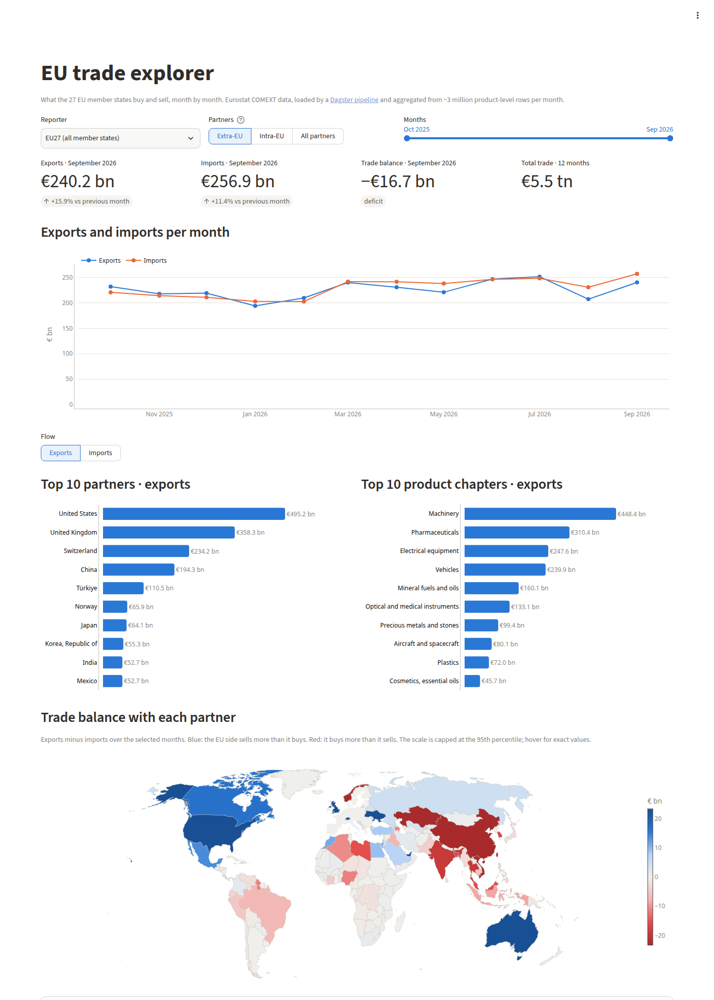
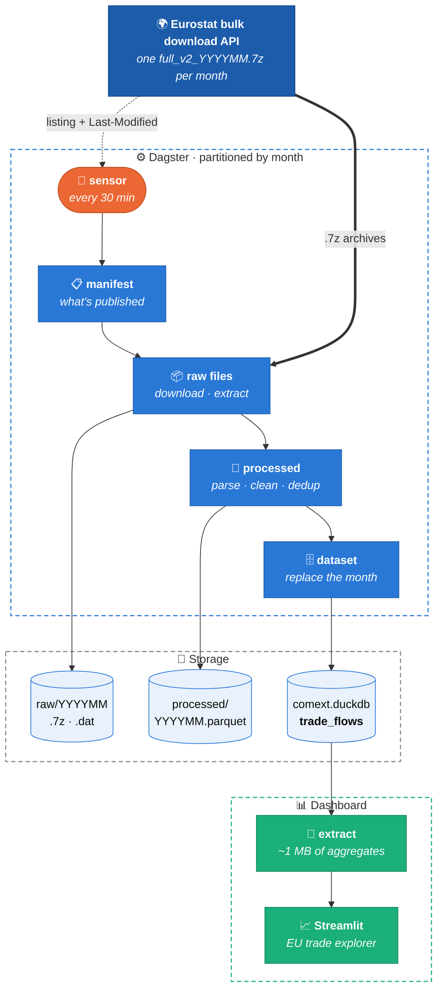
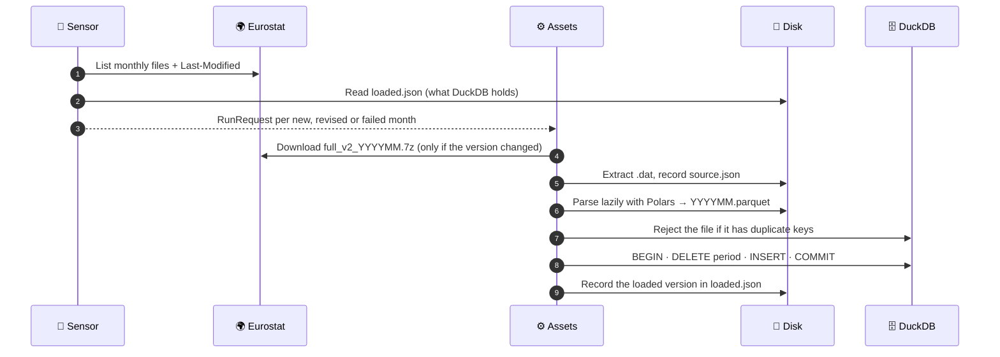
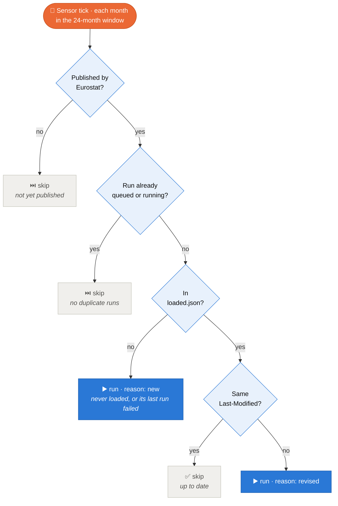

<div align="center">


# COMEXT Trade Pipeline

### Every EU trade flow, month by month, kept up to date on its own.

A production-minded [Dagster](https://dagster.io/) pipeline that downloads Eurostat's [COMEXT](https://ec.europa.eu/eurostat/web/international-trade/data/database) trade data,<br/>
cleans ~5 million product-level rows a month into DuckDB, and picks up new and revised months by itself.

<br/>

[](https://github.com/MedAmine-SUDO/comext-trade-pipeline/actions/workflows/ci.yml)
&nbsp;
[](LICENSE.md)


<br/>



</div>

<br/>

## ✨ Why this project?

Eurostat publishes one archive of EU trade per month: every member state, every partner country, every 8-digit product. Recent months run to hundreds of MB uncompressed. Then it **revises** past months, under the same filename, for up to two years.

Keeping a correct local copy is harder than downloading it once:

- 📦 **The files are big.** A recent month unpacks to ~400 MB and ~5M rows. Parsing it naively was killed for running out of memory on an 8 GB laptop.
- 🔁 **Revisions are silent.** Same filename, new content. Unless you track versions, you keep the old numbers forever.
- 💥 **Failures hide.** If "published" and "loaded" are tracked in the same place, a month that failed to load looks done and is never retried.

This pipeline handles all three, and a [Streamlit dashboard](#-dashboard-eu-trade-explorer) shows what the data says.

> **Note:** a personal portfolio project, built to learn asset-based orchestration with Dagster. It's public for reference and discussion; see [LICENSE](LICENSE.md) (CC BY-NC-ND: look and learn, please don't redistribute or repurpose commercially). Want to build on it? Reach out.

<br/>

## 🚀 Features

<table>
<tr>
<td width="50%" valign="top">

### 📡 Finds new and revised months by itself
A sensor checks Eurostat every 30 minutes and compares each month's `Last-Modified` with the version **actually loaded**. New, revised and previously failed months get a run; unchanged months cost nothing.

### 🧹 Parses big files in bounded memory
Polars scans the raw file lazily: a 396 MB month is parsed in ~4 s at ~2.4 GB peak. It handles both the current CSV and the older pipe-delimited format, by column-name aliases.

### 🗄️ Loads atomically, without indexes
Each month is replaced with `DELETE` + `INSERT` in one transaction. With no DuckDB indexes and a memory cap, a month loads in ~4 s using under 1 GB, however big the table gets.

</td>
<td width="50%" valign="top">

### 🛡️ Checked at every step
Pydantic validates a sample of every month, duplicate keys are rejected before the table is touched, and 125 tests cover the parser, sensor, resources and an end-to-end run. CI runs ruff, mypy `--strict` and pytest on Python 3.11 and 3.12.

### 🐳 Runs the same everywhere
Multi-stage Docker image: a dev target with hot reload and debugpy, and a prod target running the Dagster webserver **and** daemon as a non-root user.

### 📊 Comes with a dashboard
A one-page Streamlit app on a ~1 MB extract of the data: exports, imports, top partners, product chapters and a trade-balance map.

</td>
</tr>
</table>

<br/>

## 🏗️ Architecture



| Piece | Where | What it does |
| --- | --- | --- |
| 📡 `new_release_sensor` | `sensors/new_release_sensor.py` | Every 30 min: lists Eurostat, compares with `loaded.json`, queues one run per new / revised / failed month |
| 📋 `comext_file_manifest` | `assets/manifest.py` | The current listing: `period → filename, url, size, last_modified` |
| 📦 `raw_comext_files[month]` | `assets/raw_files.py` | Downloads the `.7z` (only if the version changed) and extracts the `.dat` |
| 🧹 `processed_monthly_data[month]` | `assets/monthly_data.py` | Parses, cleans, deduplicates and validates; writes `YYYYMM.parquet` |
| 🗄️ `comext_dataset[month]` | `assets/dataset.py` | Replaces the month in DuckDB, then records the loaded version |
| 🔌 Resources | `resources/` | `EurostatClient` (retries + circuit breaker), `FileStoreResource` (archives, manifests), `DuckDBResource` (memory cap, transactions) |

<details>
<summary><b>Each asset, step by step</b></summary>
<br/>

**`comext_file_manifest`** (not partitioned) calls `EurostatClient.list_files()`, which reads the listing as JSON or falls back to HTML, keeps the `full_v2_*.7z` files and saves `manifest.json`. Annual totals (`YYYY52`) match no monthly partition, so they are never processed.

**`raw_comext_files[month]`** looks the month up in the manifest. It reuses the archive on disk only if it is the version the manifest lists, because Eurostat publishes revisions under the same filename. Otherwise it streams a new download, extracts it with `py7zr` (falling back to the `7z` CLI) replacing any older extract, and records the version in `raw/YYYYMM/source.json`.

**`processed_monthly_data[month]`** calls `parse_comext_file()`, which:
- detects the delimiter (`,` or `|`) and resolves columns by alias (`PRODUCT_NC` → `product_code`),
- parses European and US number formats, maps `FLOW` 1/2 to `IMPORT`/`EXPORT`, fills optional columns with defaults,
- drops rows with null keys or a null/negative value, and deduplicates on the key,
- validates a random sample of 200 rows with Pydantic (`MAX_VALIDATION_ERROR_RATIO` decides warn vs fail),
- writes `processed/YYYYMM.parquet`.

**`comext_dataset[month]`** opens DuckDB with a memory limit, rejects the file if two rows share a key, and replaces the month in one transaction (`DELETE` + `INSERT`). Only then does it write the version to `loaded.json`. If anything fails, the previous version of the month stays in place and the sensor retries it.

</details>

<br/>

## 🔄 How a month flows through



The key design choice: the pipeline keeps **two** records. `manifest.json` is what Eurostat publishes right now, refreshed on every run. `loaded.json` is what DuckDB actually holds, written only after a successful load. The sensor compares Eurostat against `loaded.json`, so a month that failed halfway is never mistaken for a loaded one.

<details>
<summary><b>The sensor's decision, for each month in the 24-month window</b></summary>
<br/>



Runs carry tags (`reason: new|revised`, `period`, `remote_last_modified`), so the Dagster UI shows why each one started. When nothing changed, the sensor returns a `SkipReason` with counts ("N up to date, M not yet published").

</details>

<br/>

## 📊 Dashboard: EU trade explorer

A one-page [Streamlit](https://streamlit.io/) app (`dashboard/app.py`): exports and imports per month, the top 10 partners and product chapters, and a map of the trade balance with each partner. You can look at the EU27 or any single member state, and at extra-EU, intra-EU or all trade.

```bash
uv run --group dashboard streamlit run dashboard/app.py    # http://localhost:8501
```

It doesn't query the multi-GB database. It reads a ~1 MB extract committed in `dashboard/extract/` (monthly totals by partner and by CN chapter), so it also runs on Streamlit Community Cloud with only `dashboard/requirements.txt`. Refresh it after a pipeline run:

```bash
uv run --group dashboard python scripts/build_dashboard_extract.py                 # from DuckDB
uv run --group dashboard python scripts/build_dashboard_extract.py --from-parquet  # while a run holds the DuckDB lock
```

<details>
<summary><b>Two things the data taught the dashboard</b></summary>
<br/>

- **Each partner has a `TOTAL` product row** that repeats the sum of its CN8 rows. Summing every row doubles every figure, so the extract keeps CN8 rows only.
- **Intra-EU trade arrives late.** In the newest monthly file, all 27 member states have reported trade with the rest of the world, but only 9 have reported trade with each other. Germany's exports looked half their real size until that came out. The dashboard defaults to extra-EU trade and warns when an intra-EU month is still incomplete.

</details>

<br/>

## 🐛 Bugs found by running it for real

The unit tests passed. Loading real months on a laptop found these:

| What happened | Why | Fix |
| --- | --- | --- |
| A real month (396 MB, 4.8M rows) was **OOM-killed at 3.4 GB** while parsing | The whole file was read eagerly | Lazy Polars scan: **~4 s at ~2.4 GB** |
| A failed month was **never retried**, and revised files **never re-downloaded** | The sensor compared Eurostat with `manifest.json`, which is refreshed even when a run fails; a fixed `run_key` blocked re-runs; same filename meant "already on disk" | Compare with `loaded.json` + per-month `source.json`; no `run_key`; in-flight check. Verified live: a failed July was retried on the next tick |
| In production **the sensor never ran** | The prod image started only `dagster-webserver`, without the daemon that runs sensors | `scripts/entrypoint-prod.sh` runs both; `dagster.yaml` pool limits now apply |
| A 12-month backfill was **OOM-killed at month 10** (4.35 GB) | DuckDB keeps indexes in memory and can't spill them; the table had a 7-column primary key + 5 indexes | No indexes, duplicate check per file, `DUCKDB_MEMORY_LIMIT`: **4.2 s at 0.94 GB**, file 9.0 → 6.0 GB |
| A crash mid-load could **lose a month** | In autocommit mode the upsert's `DELETE` and `INSERT` committed separately | One explicit transaction per connection |

<br/>

## 🏁 Get started

<table>
<tr>
<td width="50%" valign="top">

### 🐳 With Docker (recommended)
No Python or 7-Zip needed. Works the same on Windows, macOS and Linux.

```bash
cp .env.example .env
make dev-d          # or: docker compose up --build -d
```

Open **http://localhost:3000**: four assets in the `comext` group, and the sensor already running. Within ~30 s it queues the last 24 months.

</td>
<td width="50%" valign="top">

### 🐍 Locally with uv
Needs Python 3.11+, [uv](https://docs.astral.sh/uv/) and 7-Zip (`p7zip-full`).

```bash
cp .env.example .env
uv sync
export DAGSTER_HOME="$PWD/.dagster"
mkdir -p "$DAGSTER_HOME" && cp dagster.yaml "$DAGSTER_HOME/"
uv run dagster dev -m comext_pipeline
```

`dagster.yaml` limits parsing and DuckDB writes to one month at a time, which keeps memory bounded.

</td>
</tr>
</table>

<details>
<summary><b>▶️ Other ways to run months</b></summary>
<br/>

- **One month from the UI:** Assets → `comext_dataset` → Materialize → partition `2024-01-01`.
- **Everything since 2002:** Assets → `comext_dataset` → Materialize all.
- **From the CLI:**
  ```bash
  dagster asset materialize -m comext_pipeline --select comext_dataset --partition 2024-01-01
  ```
- **Headless backfill script** (no run history in the UI, it uses an ephemeral Dagster instance):
  ```bash
  uv run python scripts/backfill.py --from 2025-10 --to 2026-09
  uv run python scripts/backfill.py --dry-run --all
  ```

Prefer the UI for big backfills: it tracks each partition and can resume after failures.

</details>

<details>
<summary><b>🔍 Query the result</b></summary>
<br/>

```python
import duckdb

con = duckdb.connect("data/comext.duckdb", read_only=True)

# Loaded months
con.sql("SELECT period, COUNT(*) AS rows FROM trade_flows GROUP BY period ORDER BY period")

# EU exports to the rest of the world, per month (CN8 rows only: skip the TOTAL rows)
con.sql("""
    SELECT period, ROUND(SUM(value_eur) / 1e9, 1) AS exports_bn_eur
    FROM trade_flows
    WHERE flow = 'EXPORT' AND product_code <> 'TOTAL'
      AND partner_code NOT IN ('AT','BE','BG','CY','CZ','DE','DK','EE','ES','FI','FR','GR','HR','HU',
                               'IE','IT','LT','LU','LV','MT','NL','PL','PT','RO','SE','SI','SK')
    GROUP BY period ORDER BY period
""")

# Germany's imports from China, per month
con.sql("""
    SELECT period, ROUND(SUM(value_eur) / 1e9, 2) AS imports_bn_eur
    FROM trade_flows
    WHERE reporter_code = 'DE' AND partner_code = 'CN' AND flow = 'IMPORT' AND product_code <> 'TOTAL'
    GROUP BY period ORDER BY period
""")
```

With Docker: `docker compose run --rm dagster python -c "..."` and the path `/data/comext.duckdb`.

</details>

<details>
<summary><b>🚢 Production mode</b></summary>
<br/>

```bash
make prod          # or: docker compose -f docker-compose.yml up --build -d
make prod-logs
make prod-down
```

The prod target runs `dagster-webserver` and `dagster-daemon` side by side (`scripts/entrypoint-prod.sh`) as a non-root user, with no hot reload or dev tools. The daemon runs the sensor and the run queue. If either process exits, the container exits and Docker's restart policy brings it back.

Port 3000 taken? `DAGSTER_HOST_PORT=3001 docker compose up -d`.

</details>

<br/>

## ⚙️ Configuration

Everything is set by environment variables, read from `.env` (`cp .env.example .env`).

| Variable | Default | What it controls |
| --- | --- | --- |
| `COMEXT_DATA_DIR` · `COMEXT_RAW_DIR` · `COMEXT_PROCESSED_DIR` | `./data` · `./data/raw` · `./data/processed` | Where files go |
| `COMEXT_DB_PATH` | `./data/comext.duckdb` | The output database |
| `DUCKDB_MEMORY_LIMIT` | `2GB` | DuckDB's memory cap; bigger queries spill to disk |
| `REVISION_WINDOW_MONTHS` | `24` | How far back the sensor checks for revisions |
| `SENSOR_MINIMUM_INTERVAL_SECONDS` | `1800` | How often the sensor polls Eurostat |
| `MAX_VALIDATION_ERROR_RATIO` | `0.0` | Share of invalid sampled rows that fails a run (0 = warn only) |
| `RAW_RETENTION_MONTHS` | `0` | Delete raw files older than N months (0 = keep all) |
| `EUROSTAT_BASE_URL` · `EUROSTAT_REQUEST_DELAY` | Eurostat API · `1.0` s | Source and politeness delay |
| `API_RETRY_MAX_ATTEMPTS` · `API_CIRCUIT_BREAKER_THRESHOLD` · `API_CIRCUIT_BREAKER_TIMEOUT` | `3` · `5` · `60.0` s | HTTP resilience |
| `DAGSTER_HOME` · `DAGSTER_HOST_PORT` | `./.dagster` · `3000` | Dagster state; UI port (Docker) |

In Docker, data lives under `/data` (bind-mounted to `./data` in dev) and Dagster state in the `dagster_home` volume.

<br/>

## 🗄️ The output: `trade_flows`

One row per **month × reporter × partner × flow × CN8 product × statistical procedure × supplementary unit**.

| Column | Type | Example | Notes |
| --- | --- | --- | --- |
| `period` | `VARCHAR` | `202609` | YYYYMM |
| `reporter_code` | `VARCHAR` | `DE` | EU member state reporting the flow |
| `partner_code` | `VARCHAR` | `CN` | ISO 3166 alpha-2, plus a few Eurostat-only codes (`XK`, `XS`, `Q…`) |
| `flow` | `VARCHAR` | `EXPORT` | `IMPORT` or `EXPORT` |
| `product_code` | `VARCHAR` | `84713000` | CN8; also `TOTAL` per partner, and `…XX` codes for confidential trade |
| `product_classification` | `VARCHAR` | `CN8` | |
| `stat_procedure` | `VARCHAR` | `1` | All procedures are kept (`1`, `2`, `3`, `9`) |
| `value_eur` · `value_nac` | `DOUBLE` | `1342.0` | Value in euros / national currency |
| `quantity_kg` · `supplementary_quantity` | `DOUBLE` | | Net mass; quantity in the supplementary unit |
| `supplementary_unit_code` | `VARCHAR` | `NO_SU` | `PST`, `M2`, `L`… |
| `source_file` · `ingested_at` | `VARCHAR` · `TIMESTAMP` | | Lineage |

The key above is unique: the parser deduplicates on it, and each incoming file is checked again before loading. There is **no** DuckDB index on purpose; filters on `period` use DuckDB's per-row-group min/max statistics. See [`docs/comext_data_format.md`](docs/comext_data_format.md) for the raw format.

<br/>

## 🧪 Testing & quality

```bash
uv run pytest                        # 125 tests
uv run ruff check comext_pipeline    # lint
uv run mypy comext_pipeline          # strict type check
make test                            # the same, inside Docker
```

| Suite | Covers |
| --- | --- |
| `test_parsing.py` | CSV and pipe formats, number formats, missing columns, edge cases |
| `test_sensor.py` | What's queued vs skipped: new, revised, failed, in-flight months |
| `test_eurostat_client.py` | JSON/HTML listings, downloads, retries, circuit breaker (mocked HTTP) |
| `test_duckdb_resource.py` | Upserts, idempotency, lock retries, memory limit, migration, duplicate rejection |
| `test_file_store.py` · `test_schema.py` · `test_partitions.py` | Archives and load state, Pydantic models, partition keys |
| `integration/test_pipeline.py` | All four assets end to end, with mocked HTTP |

CI ([`ci.yml`](.github/workflows/ci.yml)) runs `uv sync --locked`, ruff, mypy and pytest on Python 3.11 and 3.12 on every push to `main` and every pull request.

<br/>

## 🛠️ Debugging & troubleshooting

<details>
<summary><b>🐞 Attach a debugger (VS Code)</b></summary>
<br/>

The dev container exposes debugpy on port **5678**. Add this to `.vscode/launch.json`, start with `make dev-d`, then **Run → Start Debugging**:

```json
{
  "version": "0.2.0",
  "configurations": [{
    "name": "Attach to Dagster (debugpy)",
    "type": "debugpy",
    "request": "attach",
    "connect": { "host": "localhost", "port": 5678 },
    "pathMappings": [{ "localRoot": "${workspaceFolder}", "remoteRoot": "/app" }]
  }]
}
```

</details>

<details>
<summary><b>🔎 Where to look when something goes wrong</b></summary>
<br/>

- **A run failed:** Runs → the run → Logs. Each step logs what it read and wrote.
- **The sensor queues nothing:** Sensors → `new_release_sensor` → evaluation history. The `SkipReason` says how many months are up to date or unpublished.
- **The parser looks wrong:** run it on its own:
  ```python
  from pathlib import Path
  from comext_pipeline.utils.parsing import parse_comext_file
  df = parse_comext_file(Path("data/raw/202401/full_202401.dat"), source_filename="full_v2_202401.7z")
  print(df.schema, df.height)
  ```
- **More logs:** `dagster dev -m comext_pipeline --log-level debug`.

</details>

<details>
<summary><b>🧯 Common problems</b></summary>
<br/>

| Symptom | Likely cause | Fix |
| --- | --- | --- |
| `address already in use` on 3000 | Another `dagster dev` is running | Stop it, or `DAGSTER_HOST_PORT=3001` |
| Sensor always skips | Every month in the window is up to date | Normal. Materialize a month by hand to test |
| DuckDB `database is locked` | Another process has the file open | One writer at a time; stop other backfills or notebooks |
| `Required columns not found` | Eurostat changed column names | `head -1` the `.dat` file and extend `_COLUMN_ALIASES` in `parsing.py` |
| HTTP 429 from Eurostat | Requests too fast | Raise `EUROSTAT_REQUEST_DELAY` |
| Container exits at start | Build or config error | `make logs` |
| Load killed for memory | Limit too high for the machine | Lower `DUCKDB_MEMORY_LIMIT` |

</details>

<br/>

## 🧭 Design decisions

| Decision | Why |
| --- | --- |
| **Dagster assets, partitioned by month** | Each month is materialized, retried and revised on its own, with lineage and history in the UI |
| **Compare Eurostat with what's *loaded*** | The listing changes even when a run fails; only `loaded.json` says what DuckDB really holds |
| **Parquet between parsing and loading** | Re-loading a month doesn't re-parse it, and the dashboard extract can be built without the database |
| **DuckDB, unindexed, with a memory cap** | Columnar, single file, no server. Indexes can't spill to disk and broke loads at ~10 months |
| **Replace a whole month in one transaction** | Simpler than a row-level upsert, idempotent, and a crash leaves the old version |
| **Pools: one parse, one DuckDB writer** | Downloads stay parallel; memory and write locks stay bounded |
| **Circuit breaker + retries on HTTP** | Backs off when Eurostat is down instead of hammering it |

<details>
<summary><b>Why not…</b></summary>
<br/>

- **PostgreSQL or ClickHouse?** DuckDB gives the same analytics with zero operations at this scale (tens of GB). Past ~100 GB or with many concurrent users, ClickHouse or MotherDuck would make sense.
- **Spark?** Unnecessary on one machine. Polars' lazy engine handles a month in seconds.
- **dbt?** Most of the work here is extraction and Python parsing, which isn't dbt's model.
- **Airflow or Prefect?** Dagster's partitioned assets and sensors map directly onto "one asset per month, re-run when it changes".

</details>

<br/>

## 🧰 Tech stack

| Layer | Technology |
| --- | --- |
| Orchestration | Dagster (assets, monthly partitions, sensor, concurrency pools) |
| Processing | Polars (lazy scan), Pydantic v2 (validation, settings) |
| Storage | Parquet (per month), DuckDB (`trade_flows`) |
| Source | httpx with retries and a circuit breaker, py7zr / 7-Zip |
| Dashboard | Streamlit, Plotly, pandas |
| Tooling | uv, ruff, mypy `--strict`, pytest, GitHub Actions |
| Runtime | Docker multi-stage (dev with debugpy and hot reload, prod webserver + daemon) |

<details>
<summary><b>Project structure</b></summary>
<br/>

```
├── comext_pipeline/
│   ├── __init__.py                # Dagster Definitions: assets, resources, sensor, job
│   ├── assets/                    # manifest, raw_files, monthly_data, dataset
│   ├── resources/                 # eurostat_client, file_store, duckdb_resource
│   ├── sensors/new_release_sensor.py
│   ├── partitions/monthly.py      # Monthly partitions since 2002 + key helpers
│   └── utils/
│       ├── parsing.py             # Lazy Polars parser for both COMEXT formats
│       └── schema.py              # Settings, Pydantic models, DuckDB SQL
├── dashboard/
│   ├── app.py                     # Streamlit EU trade explorer
│   ├── requirements.txt           # Streamlit Cloud dependencies (app only)
│   └── extract/                   # Committed aggregates + code lists (~1 MB)
├── scripts/
│   ├── backfill.py                # Headless backfill
│   ├── build_dashboard_extract.py # DuckDB / Parquet → dashboard/extract/
│   └── entrypoint-prod.sh         # Prod: webserver + daemon
├── tests/                         # 125 unit + integration tests
├── docs/                          # Data format reference, screenshot, logo
├── .streamlit/config.toml         # Dashboard theme (light and dark)
├── dagster.yaml                   # Pool limits: parse = 1, duckdb = 1
├── Dockerfile · docker-compose*.yml · Makefile
└── pyproject.toml · uv.lock       # Deps; "dev" and "dashboard" groups
```

</details>

<br/>

## 🗺️ Roadmap

- [x] Lazy parsing that fits a real month in memory
- [x] Retry failed months and re-download revised ones
- [x] Run the daemon in production
- [x] Streamlit dashboard on a committed extract
- [x] Load any number of months in bounded memory
- [ ] Build the dashboard extract as a Dagster asset, refreshed after each load
- [ ] Dagster asset checks for row counts and month-on-month totals
- [ ] Full history since 2002 in the dashboard, with CN8 drill-down
- [ ] Clear the `pl.count()` and `partitions_def` deprecation warnings

<br/>

<div align="center">

Made with ☕ by [**MedAmine-SUDO**](https://github.com/MedAmine-SUDO)

If this helped you understand Eurostat trade data or Dagster, consider giving it a ⭐

</div>
